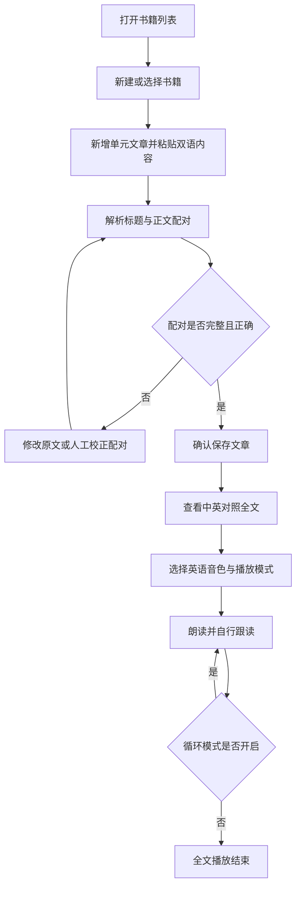

# 影子阅读项目功能规划

> 阶段：功能规划，尚未进入代码实现。
> 依据：用户提供的五项需求及 Go 编程语言中英双语文章样本。
> 项目目录：`shadow-reading`。

## 1. 产品目标与需求依据

面向零基础英语学习者，用户先借助中文理解全文，再听英语朗读并跟读。项目需要形成完整流程：新建书籍、在书籍中添加单元文章、解析并确认中英配对、保存文章、查看双语全文、单次或循环播放全文。

| 用户明确要求 | 对应功能 |
|---|---|
| 零基础学习，需要中文理解全篇文章 | 双语标题、中英对照正文、全文中文展示 |
| 使用 Chrome 提供的音色朗读全文 | 浏览器英语音色选择、全文朗读、单次播放、循环播放 |
| 用户自行添加文章，按书籍和单元组织 | 书籍管理、书内单元文章列表、文章新增与维护 |
| 添加时提供中英文，解析为合适格式 | 原文粘贴、配对解析、结构化预览、人工校正、确认保存 |
| Go、最新版 React Router、MySQL，Docker 部署数据库 | 将指定技术作为后续实现约束，见第 7 节 |

“影子阅读”在本期指看文章、听英语示范音并自行跟读。当前需求没有要求录音或自动评测，因此不引入录音、发音评分、自动翻译、词典、学习打卡或 AI 教学功能。

## 2. 规划假设与对象关系

以下为让功能规划能够完整落地而采用的建议，均为 **[规划假设，待确认]**：

1. 首期按个人使用场景规划，暂不加入账号注册、登录和多用户权限。若需要公开提供给多人使用，须先补充账号与数据隔离需求。
2. 一本书包含多篇“单元文章”；每篇文章具有单元名称，例如“Unit 1”。首期不单独建立“单元”容器，也不默认一个单元只能有一篇文章。如果后续需要“书籍 → 单元 → 多篇文章”三层结构，需调整对象关系。
3. 阅读页默认展示中英对照；用户可以隐藏或重新显示全部中文。
4. “全文朗读”按英语标题、英语正文顺序朗读，中文只用于阅读理解。提供语速调节和段落高亮，帮助初学者跟上朗读。
5. 使用提供样本的格式作为首期自动解析标准：首组为双语标题，后续为双语正文组。其他输入先由用户校正，不承诺自动识别所有排版。

### 2.1 核心对象

| 对象 | 含义 | 主要内容 |
|---|---|---|
| 书籍 | 用户组织学习材料的容器 | 名称、书内文章 |
| 单元文章 | 某书籍中的一篇学习材料 | 所属书籍、单元名称、双语标题、正文顺序、双语正文 |
| 双语正文组 | 一段英语及其对应中文 | 顺序、英语原文、中文翻译 |
| 播放设置 | 本次朗读的选择 | 英语音色、语速、单次或循环模式 |

正文以“配对段落”为单位，不强行按句号拆分。一个英文段落可包含多个句子，其中文翻译仍作为一组保存，避免破坏原有翻译对应关系。

### 2.2 核心流程



## 3. 功能规划

### FR-01 书籍管理

**页面入口**：书籍列表页。没有书籍时展示空状态和“新建书籍”按钮。

- 新建书籍时填写书籍名称，名称不能为空或全为空白。
- 创建成功后进入该书籍的单元文章列表，用户可直接添加第一篇文章。
- 列表展示书籍名称及文章数量；点击书籍进入其内容。
- 支持修改书籍名称。
- 支持删除书籍。确认窗口明确展示将一并删除的文章数量；确认后删除书籍及其文章，取消则保留全部内容。该关联删除规则为 **[规划假设，待确认]**。
- 名称是否允许重复未由用户指定，建议首期允许，不把名称作为唯一标识。
- 请求失败时保留填写内容并允许重试，不显示虚假的成功结果。

### FR-02 单元文章管理

**页面入口**：书籍详情页，展示书名、“新增文章”按钮和按顺序排列的文章列表。

新增文章时需要：

| 字段 | 规则 |
|---|---|
| 所属书籍 | 必填，从当前书籍进入时自动确定 |
| 单元名称 | 必填，用户填写，例如“Unit 1”；不从正文猜测 |
| 单元顺序 | 新增时默认追加在书内末尾；支持调整文章顺序 |
| 双语原文 | 必填，用于首次解析与预览 |
| 英语标题、中文标题 | 从原文解析，可在预览中校正，保存前均须非空 |
| 双语正文组 | 至少一组，每组英语和中文均须非空 |

- 列表展示单元名称、英语标题与中文标题，点击进入阅读页。
- 支持编辑单元名称、标题及正文配对，编辑保存成功后更新阅读内容。
- 支持删除单篇文章，操作前确认，取消不产生变更。
- 创建或编辑过程中离开页面时，如果存在未保存改动，提示用户确认离开。
- 正在播放的文章被编辑或删除时，先停止朗读，避免继续播放旧内容。
- 书籍为空时展示“添加第一篇单元文章”入口。

### FR-03 双语内容解析、预览与校正

**操作流程**：粘贴原文 → 点击“解析并预览” → 核对配对 → 校正问题 → 点击“保存文章”。解析预览不等于保存。

#### 标准输入

```text
英语标题
中文标题

第一段英语
第一段中文

第二段英语
第二段中文
```

这是用户样本的实际结构。空行用于分隔双语组；每组中英语在前、中文在后。内容如 `Go`、`WebSocket`、`gorilla/mux` 出现在中文翻译中，不会因此被判定为英语段落。

#### 解析规则

1. 统一换行格式，去除全文首尾空白，保留正文标点、大小写、专有名词和引号。
2. 将一个或多个空行视为组间分隔，不为多余空行创建空段落。
3. 标准组包含两条非空行，按第一行为英语、第二行为中文形成配对。
4. 第一组作为双语标题，其余组按原文顺序作为双语正文组。预览中允许把误识别的标题组改为正文，并单独填写标题。
5. 语言特征仅用于提示疑似错位：英文在前、中文在后是输入契约，不能仅靠有没有英文字母判断中文行。
6. 不翻译、不改写原文，不凭语义猜测缺失内容，也不默认按英文和中文句子数量进行匹配。
7. 无空行、段落换行折叠、整篇英文后接整篇中文、连续多行同一语言、缺少译文或顺序颠倒，都需要预览校正；只有配对明确的部分才能形成候选数据。
8. 不明确的内容保留在待处理区，显示原文位置及原因。不得静默丢弃、合并或保存为错误配对。

#### 预览与人工校正

- 展示双语标题、正文组数量，以及每组编号、英语和中文。
- 支持编辑每组文本、新增组、删除组、合并或拆分组、调整组顺序；通过人工操作处理折行和不匹配格式。
- 标题与正文分开编辑，避免误把标题放进正文。
- 删除已解析正文组时需用户明确操作，解析器不会自行删除输入。
- 所有待处理内容均须完成归属或由用户明确移除，必填字段完整后才能保存。
- 重新解析会替换当前预览；如预览已手动修改，先提示确认，避免覆盖校正结果。
- 修改粘贴原文后，旧预览失效，需要重新解析后才能提交。
- 保存失败保留当前预览及校正结果；保存成功进入阅读页。书籍关联、文章标题、正文配对作为一个完整结果保存，不能出现只有文章标题而正文未保存的状态。

#### 合适的数据格式

以下定义的是业务数据形状，用于统一导入、阅读和朗读理解，不是数据库建表脚本：

| 层级 | 字段 | 用途 |
|---|---|---|
| 文章 | `bookId` | 关联书籍 |
| 文章 | `unitName`、`position` | 单元名称及书内顺序 |
| 文章 | `title.en`、`title.zh` | 英语标题、中文标题 |
| 文章 | `segments` | 有序双语正文组 |
| 正文组 | `position` | 文章中的顺序 |
| 正文组 | `en`、`zh` | 英语原文、对应中文 |

保存后的书籍、文章和正文组需要稳定标识，供修改、删除及播放定位使用。标识生成方式、表结构和接口将在后续技术设计阶段确定。

### FR-04 全文阅读与中文支持

**页面入口**：从书籍中的单元文章列表进入。

- 顶部展示所属书籍、单元名称和双语标题。
- 正文按保存顺序展示，每段英语下方紧邻对应中文，用户能阅读完整文章的中文含义。
- 默认显示全部中文；提供一个“显示中文 / 隐藏中文”开关，作用于标题和整篇正文。
- 隐藏中文不删除翻译，也不改变朗读内容；重新开启时恢复全部中文。
- 播放时突出当前朗读的标题或正文组，对应中文保持配对关系。高亮按段落进行，不依赖逐词时间戳。
- 长文章高亮移出可视区域时可跟随定位，但不持续强制抢回用户主动滚动的位置。
- 阅读页提供返回当前书籍和编辑文章入口。
- 加载失败可重试；文章不存在时给出提示和返回书籍列表入口。

### FR-05 Chrome 英语音色与播放控制

#### 音色选择

- 使用 Chrome 浏览器实际提供的英语语音进行朗读，音色列表展示名称与语言，如英语（美国）、英语（英国）。
- 首次打开可先处于“音色加载中”，音色可用后再启用播放。
- 默认选择可用英语音色，用户可手动切换。不能硬编码某个品牌或名称并假定所有设备都有。
- 没有可用英语音色时，提示检查浏览器或系统语音设置；保留文章阅读功能，不用中文音色冒充英语音色。
- 提供语速调节。具体范围与默认值为 **[待确认]**；以适合初学者、音色可正常朗读为原则，在实现验证后确定。
- 更换音色或语速时，若正在播放则停止当前发声，并用新设置从当前段落开头继续；若已暂停则保留暂停状态，下次继续时从当前段落开头使用新设置。该重播段落规则为 **[规划假设，待确认]**。

#### 全文朗读

- 首次朗读必须由用户主动点击“播放”开始，不在页面打开时自动发声。
- 顺序为英语标题 → 第 1 组英语正文 → …… → 最后一组英语正文；所有内容都应被读到，不朗读中文。
- 标题和正文均以当前朗读块高亮，进度展示“标题”或“正文第 N / M 段”，不承诺精确音频时长或可拖动时间轴。
- 长段落如需内部拆为多个发声片段，对用户仍显示为同一个正文组；不改变双语数据顺序，也不漏读或重复文本。
- 多次点击播放不能叠加多个朗读队列，同一页面只有一个有效播放过程。

#### 单次与循环模式

| 控件 / 模式 | 行为 |
|---|---|
| 单次播放 | 从全文开头读到末尾后进入“已结束”，不自动重播 |
| 循环播放 | 读完全文后从英语标题开始下一轮，直到用户停止或离开文章 |
| 暂停 | 暂停当前朗读，保留本次进度和模式 |
| 继续 | 尽可能从暂停位置继续；若当前浏览器音色不能可靠恢复，提示后从当前段落开头重播 |
| 停止 | 取消当前和后续朗读，清除进度，不自动启动下一轮 |
| 再次播放 | 停止或已结束后从全文开头开始 |
| 切换播放模式 | 不打断当前轮；当前轮结束时按最新模式决定停止还是重播 |

默认采用单次模式。循环对象是当前文章的全文，不跨文章，也不是单句循环。

#### 播放状态与恢复

| 当前状态 | 用户操作 / 事件 | 结果 |
|---|---|---|
| 待播放 / 已结束 | 播放 | 开始新一轮全文朗读 |
| 播放中 | 暂停 | 进入已暂停 |
| 已暂停 | 继续 | 回到播放中 |
| 播放中 / 已暂停 | 停止 | 返回待播放 |
| 播放中 | 正常读完且单次模式 | 进入已结束 |
| 播放中 | 正常读完且循环模式 | 从全文开头继续播放 |
| 播放中 / 已暂停 | 离开文章、编辑或删除当前文章 | 停止当前朗读及循环 |
| 播放中 | 浏览器朗读报错 | 停止后续队列，显示失败提示，用户可手动重试 |

循环仅在正常读完后触发；取消、停止或报错不能被当成正常结束触发重播。重试建议从失败段落开头继续，本轮后续仍遵循当前模式。

浏览器或系统提供的部分音色可能依赖网络，不承诺所有音色离线可用。后台标签页或设备休眠可能中断朗读；回到页面后同步真实播放状态，允许用户恢复或重新开始，不显示仍在播放的假状态。

## 4. 页面清单与操作布局

| 页面 | 主要内容 | 主要操作 |
|---|---|---|
| 书籍列表 | 书籍名称、文章数量、空状态 | 新建、进入、重命名、删除书籍 |
| 书籍详情 | 书名、单元文章顺序列表 | 新增文章、打开文章、调整顺序、编辑或删除文章 |
| 新增 / 编辑文章 | 单元名称、原文输入、双语预览、待处理内容 | 解析、校正、保存、取消 |
| 阅读与播放 | 双语标题和正文、当前朗读高亮、播放状态 | 中文开关、音色、语速、单次 / 循环、播放 / 暂停 / 继续 / 停止 |

阅读页建议将播放控件保持在易触达的位置；中文使用清晰可读的排版，不依赖悬浮才能查看。核心按钮使用中文，播放中、暂停和结束状态同时用文字表达。

## 5. 使用提供样本的解析结果

该样本应解析为 **1 组双语标题 + 10 组双语正文**，单元名称由用户另外填写。

### 双语标题

- 英语：About the Go programming language
- 中文：关于 Go 编程语言

### 正文配对

| 顺序 | 英语原文 | 中文翻译 |
|---|---|---|
| 1 | Go is an open source programming language designed for building simple, fast, and reliable software. | Go 是一门开源编程语言，旨在构建简洁、高效且可靠的软件。 |
| 2 | Take a look here which great companies use Go to power their services. | 点击此处查看有哪些大型企业使用 Go 来支撑自身业务服务。 |
| 3 | Go Web Examples provides easy to understand code snippets on how to do web development in the Go programming language. | Go Web Examples 提供通俗易懂的代码片段，演示如何使用 Go 语言进行 Web 开发。 |
| 4 | It is inspired by Go By Example, which has a great introduction into the fundamentals of this language. | 该项目灵感来源于 Go By Example，后者对这门语言的基础知识做了非常棒的入门讲解。 |
| 5 | If you are learning web programming in Go or just starting out you can find some good examples and tutorials here. | 如果你正在学习 Go Web 编程，或是刚刚入门，你可以在这里找到优质示例与教程。 |
| 6 | Our goal is it to provide clean examples with great detail, so you can become the next Go web developer! | 我们的目标是提供简洁且细节丰富的示例，助你成为一名 Go Web 开发者！ |
| 7 | Go Web Examples covers the basics of web programming. | Go Web Examples 涵盖 Web 编程的基础知识。 |
| 8 | From routers and templates to middleware and websockets. | 内容涵盖路由、模板、中间件以及 WebSocket。 |
| 9 | Here you can find clean code snippets up to detailed tutorials. | 在这里，你既能找到简洁的代码片段，也能阅读详尽的教程。 |
| 10 | To get things started, check out the first example on how to create a classical "Hello World" web application or go straight to Routing (using the gorilla/mux router). | 开始学习前，可以先看第一个示例：如何搭建经典的“Hello World”Web 应用，也可以直接学习路由部分（使用 gorilla/mux 路由库）。 |

此样本的阅读结果应保留全部十组正文及翻译。单次播放按标题和十段英语依次读完；循环播放完成同样内容后再次从标题开始。中文含有英语词语的第 3、4、7、8、10 组仍必须保持正确配对。

## 6. 共享规则与异常处理

- 书籍名称、单元名称、双语标题、每组双语正文提交前均检查非空；可忽略字段首尾无意义空白，但不改变内部正文。
- 原文及预览按普通文本处理，不能将用户输入的 HTML 或脚本当作页面代码执行。
- 解析提示是候选结果，保存以用户最终确认的标题和正文组为准。
- 校验失败定位到具体字段或正文组，保留已填写数据。
- 保存进行中禁用重复提交；失败后可以重试，避免同一次操作产生重复文章。
- 取消编辑不覆盖已保存版本。刷新后的文章以已保存数据为准，首期不默认提供草稿自动保存。
- 删除书籍或文章需要明确确认，并说明影响范围；取消不能删除任何内容。
- 内容读取失败、保存失败和朗读失败分别提示，数据库服务故障不能伪装成内容不存在。
- 内容保存后重新打开仍可读取，不能仅保留在浏览器内存中。播放状态是当前页面会话状态，刷新后不自动恢复发声。

## 7. 已确定的技术约束

本节记录用户指定的技术条件，不展开代码、接口或数据库设计。

| 层级 | 用户指定条件 | 后续实现必须满足 |
|---|---|---|
| 服务端 | Go | 书籍及文章管理、解析规则、保存与读取由 Go 服务端承载 |
| 前端 | 最新版 React Router | 使用官方 Framework 模式；开发开始时核对最新稳定版本并锁定实际依赖版本 |
| 数据库 | MySQL | 书籍、文章及有序双语正文可持久化保存 |
| 数据库部署 | Docker | 使用 Docker 启动 MySQL，配置持久化数据卷、连接参数及服务就绪检查 |
| 朗读 | Chrome 浏览器音色 | 浏览器执行语音合成；音色加载和播放只能在浏览器环境运行 |

React Router 安装入口：[官方 Framework 安装文档](https://reactrouter.com/start/framework/installation)。本阶段仅记录用户指定入口，未核验当前最新版本号，也未安装任何框架。

Docker 数据库服务重建后应保留数据，正常重启不得清空学习材料。凭据通过部署配置提供，不写死在前端。Go 服务只在数据库可用时报告相应操作成功。

## 8. 实现前需要明确的产品选择

这些问题不妨碍当前功能规划，但需要在进入对应实现前定稿：

| 选择 | 当前规划建议 | 为什么需要明确 |
|---|---|---|
| 使用范围 | 个人使用，暂不加入账号 | 多用户使用会改变书籍与文章的数据归属和权限 |
| 单元与文章关系 | 书籍直接包含带单元名称的文章 | 一个单元多篇文章时需要独立单元层级 |
| 标题朗读 | 标题纳入全文朗读 | 影响播放起点和循环起点 |
| 学习辅助控件 | 提供语速和段落高亮 | 帮助零基础用户跟读，但属于本规划建议 |
| 语速默认值与范围 | 待实现验证后确定 | 浏览器和音色的实际表现不同 |
| 书籍删除 | 确认后连同文章删除 | 必须让用户知晓整本材料的删除范围 |

当前阶段完成物为本功能规划文档。下一阶段应先定稿上述影响核心模型的选择，再开展技术设计与代码实现。
